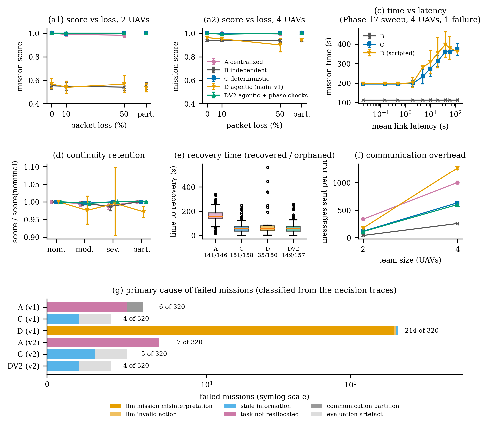

# Phase 19: conservative analysis of main_v1 and main_v2

```powershell
python scripts/phase19_extract.py results/main_v1 results/main_v2   # one row per run
python scripts/phase19_analysis.py                                  # 19.1, 19.2
python scripts/phase19_failures.py results/main_v1 results/main_v2  # 19.4
python scripts/phase19_figures.py                                   # 19.3
```

Outputs are in `paper/figure_data/`:

- `phase19_runs.csv`
- `phase19.json`
- `phase19_failures.csv`
- `phase19_failure_traces.md`

The figure is `paper/figures/fig12_degradation`. Everything is recomputed from the saved result directories; nothing was re-flown.

**Both agentic agents are analysed.**

- **D** is the agent as frozen for main_v1 (held-out seeds 1–20).
- **DV2** adds task-phase tools and checks (disclosed follow-up, seeds 21–40).
- They never flew the same seeds, so they are compared only through their paired difference from C, each on its own seeds.
- A, B and C were re-run on both seed sets and are stable: C 98.8% / 98.4% success, 256 s / 257 s; A 98.1% / 97.8%, 319 s / 317 s; B 27.5% / 27.5%.

## Research questions

1. Is the agentic architecture as reliable and as efficient as centralized and deterministic decentralized control?
2. Does its degradation curve differ as communication worsens and team size changes?
3. How quickly does each architecture recover from a lost UAV?
4. What does each cost in communication and latency?
5. How and why do missions fail, and what does the safety guardian catch?

## Conventions

- **Pairs.** Two runs pair if they have the same seed, team size, network and failure condition. Comparisons are made within a design only.
- **Confidence intervals.** 95% bootstrap intervals that resample **seeds** (20 clusters, 4,000 resamples). Under common random numbers one seed appears in all 16 cells of an architecture, so pairs from one seed are not independent.
- **Effect sizes.** Cohen's *d_z* (mean / SD of the paired difference) and the probability of superiority *PS* = P(Δ > 0) + ½ P(Δ = 0). For success, the risk difference with exact McNemar counts.
- **Mission score.** `0.5·coverage + 0.3·target detection + 0.2·safe return`, using the docs/METRICS.md weights, fixed before any run.
- **Mission time.** The time each run ended, for every run. Completion time (both runs successful) is reported alongside it.
- **One run with no logs.** `DV2_n2_nominal_one_failure_s25294` was re-run under X1. It counts as a success, as on re-run. Its logs were not in the analysed archive, so it is absent from continuous metrics (n = 319).

## 19.1 Paired comparisons

Δ = first architecture − second, on the same mission. Success Δ is a rate difference; time is in seconds.

| design | comparison | success Δ (95% CI) | McNemar (x-only / y-only) | score Δ, mean / median (CI) | time Δ, mean / median (CI) | effect size |
|---|---|---|---|---|---|---|
| main_v1 | **D − C** | −0.656 (−0.688, −0.622) | 3 / 213, p = 3×10⁻⁵⁹ | −0.253 / −0.158 (−0.272, −0.234) | +460 / +478 (443, 475) | score *d_z* −1.06; time *d_z* 3.45 |
| main_v1 | **D − A** | −0.650 (−0.688, −0.609) | 0 / 208, p = 5×10⁻⁶³ | −0.250 / −0.125 | +396 / +414 (380, 412) | score *d_z* −1.06 |
| main_v2 | **DV2 − C** | +0.003 (−0.009, +0.016) | 3 / 2, p = 1.0 | 0.000 / 0.000 (−0.002, +0.001) | **+4.0 / 0.0 (+0.8, +7.3)** | time *d_z* 0.08 |
| main_v2 | **DV2 − A** | +0.009 (−0.006, +0.025) | 7 / 4, p = 0.55 | +0.003 / 0.000 | −56 / −57 (−64, −48) | time *d_z* −0.77 |
| main_v1 | C − A | +0.006 (−0.019, +0.031) | 6 / 4, p = 0.75 | +0.004 / 0.000 | −63 / −55 (−72, −55) | time *d_z* −0.85 |
| main_v2 | C − A | +0.006 (−0.009, +0.022) | 7 / 5, p = 0.77 | +0.003 / 0.000 | −60 / −55 (−68, −53) | time *d_z* −0.79 |
| main_v1 / main_v2 | (DV2 − C) − (D − C) | +0.659 (+0.622, +0.694) | – | +0.253 (+0.234, +0.272) | −456 (−471, −439) | difference in differences |

**How the paired differences are distributed across missions**

| comparison | share where the first is better / equal / worse | time Δ quantiles (10th, 25th, 50th, 75th, 90th) |
|---|---|---|
| D − C, success | 1% / 33% / 67% | – |
| D − C, time | – | +299, +379, +478, +543, +596 s |
| DV2 − C, success | 1% / 98% / 1% | – |
| DV2 − C, time | DV2 faster in 21%, equal in 43%, slower in 36% | −21, −12, 0, 0, +60 s |
| DV2 − A, time | DV2 faster in 87% | −134, −83, −57, −23, +16 s |

**Findings**

- **D is worse than both baselines on every primary metric, with very large effects.** It lost 213 of the 216 discordant missions against C.
- **DV2 is equivalent to C on success and score.** It is 4 s slower on mission time on average.
  - The interval excludes zero, but the median difference is 0 and *d_z* = 0.08, so the difference is practically negligible.
  - The difference is not uniform. DV2 is faster on about a fifth of missions and slower on about a third. The slow tail (90th percentile +60 s) sits in the severe-loss condition (19.2).
  - *Correction to RESULTS_main_v2.md and the draft paper:* those reported "C faster by 3.8 s, 95% CI −9.9 to 2.0 s, not significant", from a pair-level bootstrap. Under the seed-clustered bootstrap used here the CI is +0.8 to +7.3 s. The correct description is "statistically detectable but negligible", not "no difference".
- **DV2 and C are both about a minute faster than A,** at the same reliability.

## 19.2 Interaction model: do the degradation curves differ?

Model, fitted separately per design (each design has its own agentic arm):

`outcome ~ architecture × network × team size + failure`

- OLS, which is a linear probability model for success.
- Standard errors are clustered by seed.
- Reference cell: C, nominal, 2 UAVs.
- B is excluded: it never communicates, so its outcome is identical in every network by construction.

Joint Wald tests of the interaction terms:

| design | outcome | architecture × network | architecture × network × team | architecture × team |
|---|---|---|---|---|
| main_v1 (A, C, D) | success | χ²(6) = 12.4, p = 0.055 | χ²(6) = 22.6, **p = 0.0009** | p < 10⁻²² |
| main_v1 | time | **p < 10⁻²⁶⁰** | **p = 7×10⁻⁶** | p < 10⁻⁸⁵ |
| main_v2 (A, C, DV2) | success | χ²(6) = 7.9, p = 0.16 | χ²(6) = 6.5, p = 0.16 | p = 1.0 |
| main_v2 | time | **χ²(6) = 22.3, p = 0.001** | **p = 10⁻⁹** | p < 10⁻¹⁰ |

The same question can be asked without a model. For each architecture, take the paired change from nominal within seed, team size and failure condition. Then compare those changes between architectures, also paired by seed.

| design | condition | change in time from nominal (s, 95% CI) | difference in that change between architectures |
|---|---|---|---|
| main_v2 | severe (50% loss) | A +117 (98, 137); C +82 (69, 94); **DV2 +104 (90, 119)** | **C − DV2 = −21 s (−36, −7)**; A − C = +35 s (9, 62) |
| main_v2 | moderate (10%) | A +6; C +23; DV2 +27 | C − DV2 = −4 s (−9, +1) |
| main_v2 | partition | A +61; C +63; DV2 +68 | C − DV2 = −4 s (−8, −1) |
| main_v1 | severe | A +130; C +84; D −26 | – (D's time is set by its battery, not the network) |

| design | condition | change in success from nominal |
|---|---|---|
| main_v2 | severe | A −6.3 pts (−11, −2.5); C 0; DV2 0 |
| main_v2 | moderate | A −2.5; C −6.3 (−11, −2.5); DV2 −5.0 (−10, −1.3) |
| main_v1 | partition | D −8.8 pts (−15, −2.5); A −1.3; C 0 |

**Findings**

- **Success.** DV2's success curve does not differ detectably from C's (p = 0.16). Both stay at 100% under severe loss, while A loses about 6 points there.
- **Time.** DV2's time curve does differ. It slows more than C as loss rises: an extra 21 s under severe loss, and a few seconds more under moderate loss and partition. Communication degradation costs the agentic agent more time than the deterministic one, though not more failures.
- **D's success interaction is with team size, not network** (p = 0.0009 for the three-way term). D fails almost every 2-UAV mission in every network condition (3.8%) and about a third of 4-UAV missions. Its time barely depends on the network, because its missions end when the battery reserve forces a return.

## 19.3 Degradation curves



| panel | what it shows | finding |
|---|---|---|
| (a1, a2) score vs packet loss | 2 and 4 UAVs; partition at right | A, C and DV2 stay at a score of 0.98–1.0 at every loss level. D sits at about 0.55 with 2 UAVs and 0.90–0.96 with 4 UAVs at every loss level: flat, because its failures do not come from the network. B is flat by construction. |
| (b) time vs latency | Phase 17 calibration sweep only (4 UAVs, one failure, 10 seeds; B, C and **scripted** D) | Time is flat up to 2 s mean latency, then rises steeply for C and D alike. The factorial held latency at 150 ms, so no LLM-agent latency curve exists. This is a gap, not a result. |
| (c) continuity retention | score(condition) / score(nominal), same seed | Within 3% of 1.0 for A, C and DV2 in every condition. D retention is noisy (its nominal score is already low). |
| (d) recovery time | time from the failure until a teammate flies toward the lost drone's unfinished sector | See the recovery table below. |
| (e) communication overhead | messages sent per run vs team size | A: 336 → 1,002 messages from 2 to 4 UAVs (×3.0). C: 118 → 634 (×5.4). DV2: 111 → 601 (×5.4). D: 176 → 1,266 (×7.2). B: 41 → 258. DV2 sends slightly fewer messages than C (−20 per run, CI −28 to −12); D sends many more (+351). Decentralized traffic grows faster than team size, so 8 UAVs remains the real scaling test. |

**Recovery after a lost UAV**

| architecture (design) | orphaned sector recovered | median time to a teammate heading for it (IQR) | gap vs C on the same missions |
|---|---|---|---|
| A (v2) | 141 of 146 | 153 s (137–186) | +92 s (81–104) |
| C (v2) | 151 of 158 | 58 s (36–74) | – |
| DV2 (v2) | 149 of 157 | 58 s (36–74) | 0.0 s (−2.0, +1.8) |
| D (v1) | **35 of 150** | – | its drones were still re-searching their own sectors |

DV2 *starts sweeping* the orphaned sector 14 s earlier than C. Inspection shows this is skill sequencing, not faster recovery. DV2's `start_search` folds the transit into the sweep skill, so it uses `go_to_waypoint` 6 times in a 40-run sample against C's 99 times.

## 19.4 Failure modes, classified from the decision traces

`scripts/phase19_failures.py` gives every failed mission one primary cause and its contributing factors, using written rules in a fixed order (listed in the script header). It also writes a trace excerpt per class to `phase19_failure_traces.md`. The excerpts and the individual runs below were inspected by hand.

B's 464 failures are all by design: it never reallocates work, so every 2-UAV run and 95% of runs with a failure leave a sector unsearched. They are not classified further.

| primary cause | A v1 | C v1 | **D v1** | A v2 | C v2 | **DV2 v2** |
|---|---|---|---|---|---|---|
| LLM_MISSION_MISINTERPRETATION (phase perseveration) | – | – | **201** | – | – | 0 |
| LLM_INVALID_ACTION → agent loop exited airborne | – | – | **9** | – | – | 0 |
| STALE_INFORMATION (allocation left stale by a lost message) | – | 2 | 4 | – | 3 | 2 |
| TASK_NOT_REALLOCATED | 5 | – | – | 7 | – | – |
| COMMUNICATION_PARTITION | 1 | – | – | – | – | – |
| EVALUATION_ARTEFACT (idle drone on its pad scored "not home") | – | 2 | – | – | 2 | 2 |
| ROLE_OSCILLATION, CONFLICTING_CLAIMS as primary | 0 | 0 | 0 | 0 | 0 | 0 |
| SAFETY_GUARDIAN_DEADLOCK | 0 | 0 | 0 | 0 | 0 | 0 |
| INSUFFICIENT_BATTERY as primary | 0 | 0 | 0 | 0 | 0 | 0 |
| NAVIGATION_FAILURE | 0 | 0 | 0 | 0 | 0 | 0 |
| **failed missions** | 6 | 4 | 214 | 7 | 5 | 4 (+1 re-run) |

**What each class is, and the trace evidence**

1. **LLM_MISSION_MISINTERPRETATION (D only: 201 runs).** The model kept choosing `start_search` for a sector its own context reported as searched. That happened 5,431 times out of 8,054 accepted decisions.
   - Typical trace (`D_n2_nominal_none_s11837`): each drone re-flew its own sector every 80 s, from t = 4 s to t ≈ 650 s, until the `battery_reserved_for_safety` fallback sent it home. That gives coverage 0.5 with both drones safe and landed.
   - Battery is a consequence here, not the cause.
   - DV2 had **0** accepted perseverating decisions. Its phase check rejected 1,005 such attempts, 824 of which the model corrected itself.
2. **LLM_INVALID_ACTION (D: 9 runs).** A model reply was rejected (an invented message type in `send_bid`), and the agent's loop then ended with the drone airborne.
   - Example: `D_n2_moderate_one_failure_s11837` ended at t = 4.7 s.
   - This is the lifecycle defect found in main_v1. It was fixed for DV2, where it did not recur.
3. **STALE_INFORMATION (C 5, D 4, DV2 2; 10 of 11 under 10% loss).** Every one of the 11 traces shows the same mechanism:
   - A drone has swept its sector but still holds it as its task.
   - A coordination message (a completion acknowledgement or the next award) was lost; 3–8 coordination messages to that drone were dropped (55 in the one severe-loss case).
   - The drone keeps proposing `claim_task`. A claim takes no simulated time, so it re-decides up to 124 times at one instant until its 160-step budget runs out with it in the air.
   - Example: `C_n2_moderate_none_s31772`, where Drone2 holds S4 (swept at t = 16 s) and loops at t = 158 s.
   - **This is a defect of the shared allocation and lifecycle code, not of the LLM.** It occurs equally in the deterministic agent C. *Correction:* RESULTS_main_v2.md called `DV2_n4_moderate_none_s83088` a "DV2-specific failure"; it is this shared defect.
4. **TASK_NOT_REALLOCATED (A only: 12 runs).** Under loss with a failure, A's controller left a sector unassigned while the survivor still had battery to spare (62% in the example), and the survivor declared "no work available".
   - Example: `A_n2_moderate_one_failure_s29435`, where Drone2's S2 was never reassigned after it stopped at 72.5 s.
5. **EVALUATION_ARTEFACT (C 4, DV2 2).** A drone that lost every bid never took off and sat on its own pad. The success metric counts only drones that *landed*, so it was scored "not home".
   - Examples: `C_n4_severe_none_s77959`, `C_n4_moderate_none_s18435`.
   - Nothing failed in flight. Re-scored with a grounded drone counted as home (a sensitivity analysis, not the predeclared metric): C v1 99.4%, C v2 99.1%, DV2 99.4%. No comparison changes.
6. **COMMUNICATION_PARTITION (A: 1 run, `A_n4_partitioned_one_failure_s97230`).** Drone3 failed at 81.5 s, during the partition, on the half of the team cut off from the controller. Its sector S4 was never reassigned before the mission ended.

**Contributing factors and the guardian**

- **CONFLICTING_CLAIMS** (a sector flown twice) contributed to 23 D failures and is common in successful runs too.
  - DV2 duplicates slightly more than C (+0.22 sectors per run, CI 0.16–0.27). D duplicates less, because its drones rarely leave their own sector.
- **The guardian intervened** in 17 A, 61 C and 13 DV2 runs in main_v2.
  - Almost all were separation rejections at 0.0 m: two drones on the same sweep at the same moment, a direct result of conflicting claims. When rejections repeated, it escalated to a safe return.
  - No failed mission was a guardian deadlock.
- **What the guardian did not catch:** D's 5,431 perseverating decisions (each one individually safe), the stale-allocation loops, or the idle drones.
  - The DV2 phase check, not the guardian, removed perseveration.

**Measurement note.** The `sector_searched` event is stamped at the sweep's start in some runs and at its end in others. Timing in this analysis uses the sweep's own `started_at`. Coverage and mission time do not depend on it.

## 19.5 Trade-offs, stated plainly

| expected trade-off | verdict on this evidence |
|---|---|
| Centralized control is more efficient under nominal conditions | **Not supported.** Under nominal conditions A is 56 s slower than C (CI 52–62) and 60 s slower than DV2 (CI 56–65), sends 3× as many messages as C at 2 UAVs, and takes 92 s longer to recover a lost UAV's sector. |
| Deterministic decentralized control is more predictable | **Supported, narrowly.** C and DV2 have the same success. DV2's mission time is more variable against C (faster on 21% of missions, slower on 36%) and degrades 21 s more under severe loss. D was far less predictable. |
| Agentic control handles unexpected mission changes better | **Not tested.** No condition introduced a mission change the rules were not written for. This is the condition under which an agentic advantage could appear, and it is the next design to run. |
| Agentic control incurs more latency and communication overhead | **Latency: yes.** 16.3 s per decision on a 4 GB laptop GPU, about 5 min of model time per run, excluded from simulated mission time. **Messages: no for DV2** (−20 per run vs C); **yes for D** (+351). |
| The safety guardian corrects some but not all poor decisions | **Supported.** It resolved every physical conflict it saw (separation), but none of the mission-level failures: perseveration, stale allocation, idle drones. Those were fixed by task-phase validation (DV2) or remain open defects. |

## What each conclusion rests on

| conclusion | quantitative evidence | trace inspected |
|---|---|---|
| D fails because it repeats completed work, not because of the network | success flat across networks (27.5–36.2%); 5,431 / 8,054 perseverating decisions; 201 runs classified | `D_n2_nominal_none_s11837` |
| DV2 matches C on reliability | success Δ +0.003 (−0.009, 0.016); McNemar 3 / 2 | – (no discordant failures to inspect beyond 19.4) |
| DV2 is slower than C under severe loss | degradation difference −21 s (−36, −7) | timing only; the cause was not isolated (open) |
| Stale-allocation loops are shared, not LLM-specific | 11 runs across C, D and DV2, same signature | `C_n2_moderate_none_s31772`, `DV2_n4_moderate_none_s83088`, `D_n4_moderate_none_s46452` |
| Some "failures" are idle drones scored as not home | 6 runs, never took off | `C_n4_severe_none_s77959` |
| A recovers slowest | +92 s vs C (81, 104) | `A_n2_moderate_one_failure_s29435` |
| DV2's earlier sweep start is skill sequencing | `go_to_waypoint` 6 vs 99 | `DV2` vs `C` n4 nominal one-failure skill counts |
| Guardian catches physical, not mission-level, faults | separation rejections only; 0 deadlocks; perseveration uncaught | guardian events in C and DV2 runs |

## Open items

1. **Stale-allocation loop.** Fix it: a decision that cannot progress should consume simulated time and eventually release the held task. Add it to the defect catalogue. This needs a new design and new seeds, because main_v1 and main_v2 are sealed.
2. **"Home" metric.** Decide whether a drone that never took off counts as home. Predeclare the decision before the next design.
3. **Latency not varied.** No latency × architecture data exists for the LLM agents.
4. **8 UAVs not run.** Stage 2 is needed for the communication-overhead question.
5. **Unexpected mission changes not tested.** This is the only route to an agentic advantage that this evidence leaves open.
