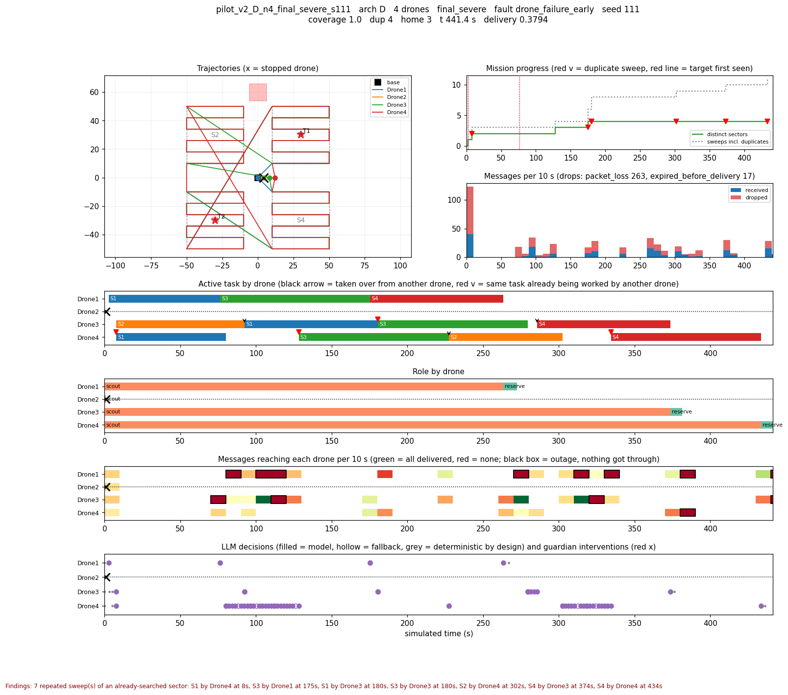
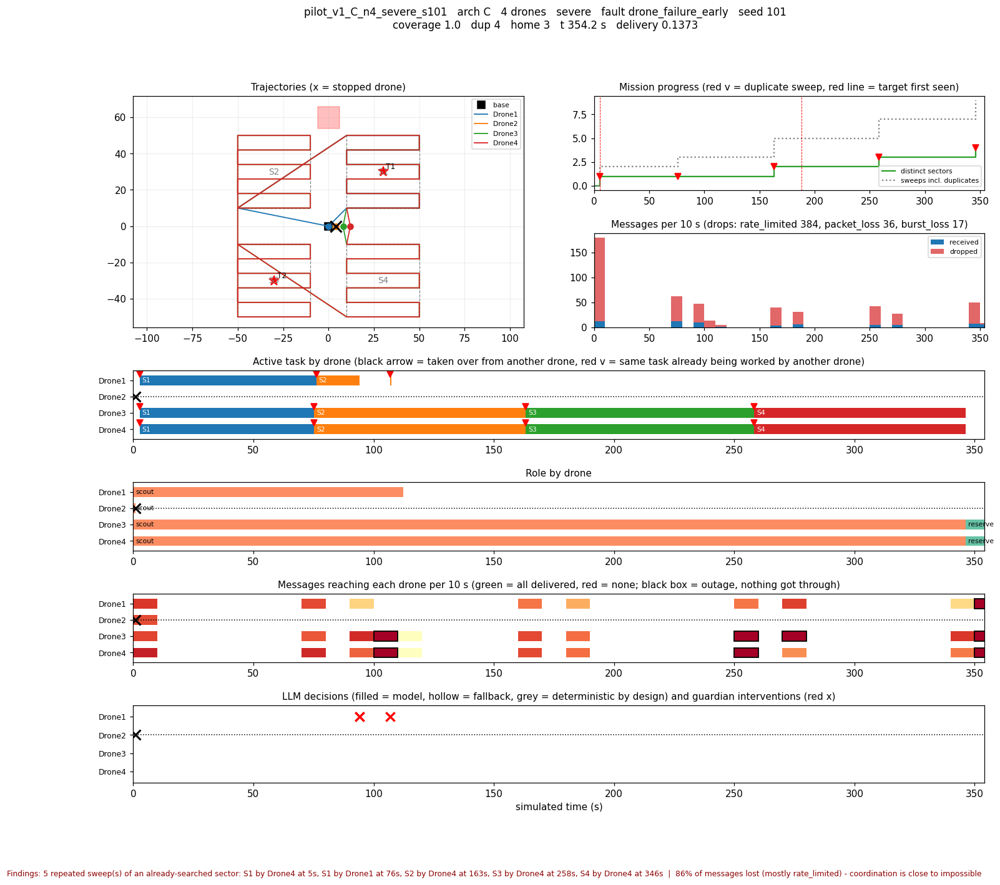
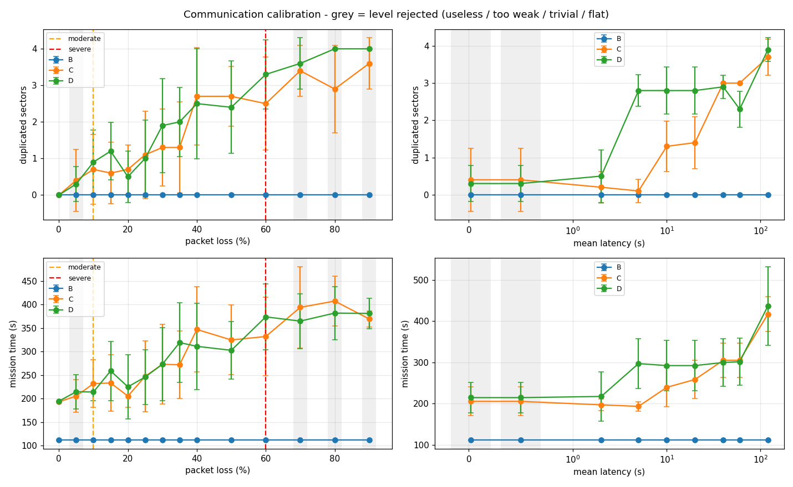

# Phase 17: pilot experiments

Pilots debug the methodology. Nothing in this document is a result about the
architectures; it is a record of what the pilots found wrong with the
*experiment*, what was changed because of it, and what is now frozen.

```powershell
python scripts/run_pilot.py configs/experiments/pilot_matrix.yaml       # 17.1 + 17.2, first pass
python scripts/calibrate_comms.py configs/networks/calibration_ladder.yaml --write-final   # 17.3
python scripts/run_pilot.py configs/experiments/pilot_matrix_v2.yaml    # second pass, calibrated levels
python scripts/freeze.py                                                # 17.4: check nothing frozen changed
```

All of it runs on the mock adapter in under a minute. Outputs go to
`results/pilot_v1/`, `results/pilot_v2/` and `results/calibration/`, each with
a Markdown report; every run directory also gets a `timeline.png`.

## 17.1 The matrix

| factor | levels |
|---|---|
| architecture | C deterministic decentralized, D agentic decentralized |
| team size | 2, 4 drones (the first *n* vehicles of `search_relay_001`; all 4 sectors kept) |
| network | first pass: Phase 10 `nominal`, `severe`. Second pass: the calibrated `final_*` levels |
| failure | `drone_failure_early` - Drone2 stops at t = 1 s |
| seeds | 5 per cell; pilot seeds are never reused (17.4) |

40 runs in the first pass, 60 in the second. D uses the scripted stand-in
planner, so the pilot checks the plumbing of the agentic path, not a model's
judgement. One real-model pass (`planner: llama3.1:8b`) is still to do before
the final runs. Budget for it: an idle D drone calls the model on every
waiting round, which is 20 or more calls in a row in some runs.

`team_size` used to be warned about and ignored ("the scenario wins"). It is
now applied: the first *n* vehicles fly, every sector stays in the mission, and
a fault aimed at a drone outside the team is skipped and recorded in the
manifest.

## 17.2 Timelines

`agentic_uav/experiments/timeline.py` draws one figure per run with the nine
views 17.2 asks for:

- trajectories
- active task by drone
- role by drone
- messages over time
- communication quality per drone
- task reallocations and concurrent claims
- LLM decisions
- guardian interventions
- mission progress

**It reads only the result directory** (`events.jsonl`, `tracks.json`,
`manifest.json`, `result.json`). That is deliberate: if a run can be
reconstructed from its logs, the logs are complete. To make that possible the
event stream now carries each drone's task, role and position on every step. A
completed sector sweep is now an event at the time it *ended*. Flown tracks and
the map are written to `tracks.json`.



### What the timelines found

Every one of these was invisible in the aggregate numbers. Four were real
defects, and each now has a regression test in `tests/test_pilot.py` and an
entry in the defect-injection catalogue (20/20 caught).

1. **A dead drone's bid blocked the survivor forever.**
   - *Aggregate:* 2 drones, nominal comms, coverage 0.75.
   - *Timeline:* the survivor asks to claim S4 four times, then flies home.
   - *Cause:* Drone2 had bid 0.336 on S4 against Drone1's 0.340 before it died. A dead drone is never "busy", so its bid stayed in the pool and kept winning.
   - *Fix:* bids from presumed-lost drones are ignored.
2. **Faults landed one skill late.**
   - *Cause:* the kill time was compared with the drone's *belief* clock, which is the time it last observed. That lags a whole skill.
   - *Effect:* a drone killed at t = 1 s was still at t = 0 after take-off and got one more turn. An LLM drone used that turn to fly a complete 70 s sweep while "dead", and its sector then showed up as duplicated.
   - *Fix:* the adapter clock is used.
3. **A grounded drone quit while waiting for bids.**
   - *Condition:* 10% loss.
   - *Cause:* a drone still on its pad whose rivals' bids were lost had nothing new to react to, so it was treated as finished. It never took off, and the failed drone's sector was never flown.
   - *Fix:* it waits on the pad (1 s at a time, at most 60 times) while work is still open to it.
4. **An idle drone gave up in zero time.**
   - *Condition:* 30% loss.
   - *Cause:* on a simulated clock an idle round takes no time, so "wait three rounds for work" was instantaneous. A drone lost its sector in a claim conflict to a teammate that had already failed, and it landed at t = 3 s, before anyone could notice the failure.
   - *Fix:* while work is open, an idle drone hovers 2 s per round, at most 30 times.
   - *Knock-on change:* this made the Phase 16 partition test fail. Its old assertion held only because of the same artefact. The test now asserts what is actually guaranteed: no sector is flown twice by drones that can hear each other. Across a partition longer than the presumed-lost threshold, each half reclaims the other's work. That is the design, *silence is failure*, and it is worth discussing.

Two more findings changed the experimental design rather than the code:

5. **The Phase 10 `severe` profile was not measuring the network.** Its 4 msg/s
   rate limit drops about 85% of messages. In the stepped simulator a drone sends
   all of a step's messages at the same simulated instant, so the limiter, not
   the packet loss, decides what arrives, and it decides the same way for every
   seed. In the first pass every cell gave **identical results for all five
   seeds**: repeated seeds would have added no information at all. Under it, the
   three survivors flew every sector together as a pack (figure below).
6. **A 2-drone team with one failure is a solo drone.** With one survivor
   there is nobody to talk to, so the network condition cannot matter. C and D
   give the same mission time under every network. A 2-drone cell measures solo
   recovery only. For the final design, either fail a drone later in 2-drone
   runs or compare network conditions only at 4 drones.



## 17.3 Calibrating the communication conditions

`scripts/calibrate_comms.py` sweeps a ladder of profiles, defined in
`configs/networks/calibration_ladder.yaml`:

- **Packet loss:** 0–90% at 150 ± 50 ms.
- **Latency:** 20 ms – 120 s at 5% loss.

Each level is run with B, C and D at 4 drones with the failure, over 10
calibration seeds. B never coordinates, so it is the "communication cannot
help" reference: it is unaffected at every level, as it should be. Each level
is then classified by the written rules in the ladder file:

| verdict | rule |
|---|---|
| useless | < 25% of messages arrive; *or* latency ≥ the presumed-lost threshold (4 heartbeats = 32 s); *or* every coordinating architecture duplicates ≥ 90% of sectors |
| too weak | < 0.5 duplicated sectors and mission time within 15% of loss-free, for every coordinating architecture |
| trivial | ≥ 95% clean success for every architecture; *or* the mission fails ≤ 5% … for every architecture; *or* no clean success with ≥ 75% of sectors duplicated |
| flat | every seed gives the same outcome |

*Clean success* = every sector searched, every survivor home, no sector flown
twice.



### The final levels, and why each is meaningful

| level | profile | why |
|---|---|---|
| `final_nominal` | 0% loss, 150 ± 50 ms | The loss-free reference. C and D both: 0 duplicates, ~194 s, 100% clean success. |
| `final_moderate` | 10% loss, 150 ± 50 ms | The mildest level where coordination visibly suffers. Duplicates appear (C 0.7 ± 0.9, D 0.9 ± 0.9) and time rises (C 232 s, D 214 s), but most runs still succeed or nearly do. 5% loss is *too weak*: time within 15% and under half a duplicate. This is the Phase 10 `moderate` profile exactly, so the calibration confirms it. |
| `final_severe` | 60% loss, 150 ± 50 ms | The harshest level where communication is still worth having. 38% of messages arrive and duplication is high but not saturated (C 2.5 ± 1.3, D 3.3 ± 0.9 of 4), so the architectures can still be told apart. At 70% loss neither can succeed cleanly and three-quarters of the sectors are flown twice (*trivial*); at 80% fewer than a quarter of messages arrive (*useless*). |

Moderate and severe differ in one parameter, loss, so a difference between them
has one cause. The old `severe` is kept for reproducing Phase 10, but is
classified *flat* and *useless*.

**Latency is a separate, informative axis.** Up to 2 s it barely matters. At
5–20 s, D duplicates about 2.8 sectors while C stays below 1.5: the agentic
architecture is much more sensitive to delay than to loss. At 40 s and beyond,
latency exceeds the presumed-lost threshold and every message is too late
(*useless*). If the paper wants a latency condition, 5 s at 5% loss is usable
and separates C from D sharply.

**Seed budget.** Under the calibrated levels, outcomes now vary between
seeds, which is the point. They vary a lot: ±1.3 duplicated sectors and ±120 s
in some cells. To detect a 1-sector difference in duplicates at α = 0.05 with
80% power, a two-sample comparison needs about 2·(1.96 + 0.84)²·1.2² ≈ 23 runs
per cell. Plan on **25 held-out seeds per cell**.

## 17.4 What is frozen

`scripts/freeze.py --write` fingerprinted six groups into
`configs/frozen/freeze.json`:

| group | contents |
|---|---|
| prompts | LLM system prompt, tool set, decision-schema limits, guardrail benchmark prompt and suite |
| task rules | bid weights and limits, lease, bid window, health thresholds, the agent's waiting rules, and the source of the files that implement them |
| metrics | metric definitions, score weights, collision radius, separation sampling, `evaluation.py` |
| networks | the three `final_*` profiles, message lifetimes, the network model |
| scenarios | every mission file, the named failure profiles |
| seeds | 100 held-out seeds in `configs/frozen/heldout_seeds.yaml` |

The held-out seeds are drawn deterministically from a fixed tag (anyone can
regenerate and check them). They are disjoint from every pilot and calibration
seed, and a pilot or calibration that tries to use one is refused.

`python scripts/freeze.py` (also run by `run_all_tests.py`) reports any change
by name, for example `task_rules.lease_s: 120.0 -> 150.0`. Source files are
hashed with line endings normalised, so Windows and Linux checkouts agree. A
deliberate change needs `--refreeze --reason "..."`, which records the reason;
results on either side of a refreeze are not comparable.

**Two open decisions will need a refreeze if they are taken:**

- **The first-mover allocation fix.** Hold position while a bid window is open, and count peers from the roster.
- **Whether the simulator-only behaviours become defaults.** These are stand-by, completion gossip and the 30 s heartbeat.

Both change task rules. Decide them before the final runs, then refreeze once.

## Exit criterion

- **Each final communication level is meaningful.**
  - The table above, generated from the calibration report.
  - The rules are written down in the ladder file.
  - Each level is placed relative to the levels that were rejected and why.
- **The runner produces complete, interpretable logs.**
  - `pilot.audit_run` checks every result directory: all files present, every expected event type, per-drone task/role/position, a flown track per drone.
  - It also checks that the event stream *agrees with the reported result* (the sectors and duplicates the events show are the ones the result counts).
  - All 100 pilot runs pass (40/40 and 60/60), and every timeline is drawn from the logs alone.
