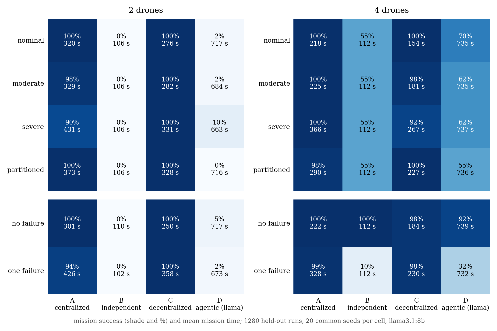
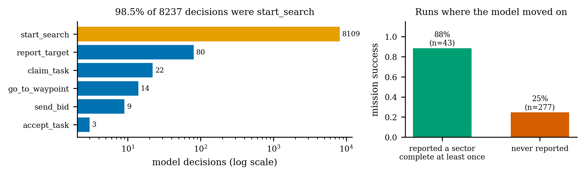

# Phase 18 results: main_v1 (stage 1, held-out seeds)

```powershell
python scripts/analyse_factorial.py results/main_v1
python scripts/make_paper_figures.py --only fig8
python scripts/make_paper_figures.py --only fig9
```

The numbers below come from `paper/figure_data/factorial_main_v1.json`, which
the first command writes from `results/main_v1/` alone.

## Run summary

**The run**

- Design `main_v1`: 4 architectures × 2 team sizes × 4 network conditions × 2 failure conditions = 64 cells.
- 20 common held-out seeds per cell.
- Planner: llama3.1:8b through Ollama, temperature 0.
- Configuration sealed 2026-11-07 (`configs/frozen/test_seal.json`).

**Validity**

- All 1,280 recorded runs are valid.
- Every cell has 20 of 20 replications (18 required), so the exit criterion is met.

**One interrupted attempt**

- `D_n2_final_nominal_none_s47267`, attempt 1, was stopped with Ctrl+C while switching Ollama to the GPU.
- That is exclusion X1 (operator interrupt). It is kept as evidence in `results/main_v1/_excluded_attempts/`.
- The seed was then re-run in full.

**Hardware change before most D runs ran**

- The D runs done on CPU before that switch were deleted and re-run, so every recorded D run used the same setting (`num_gpu: all`, recorded in each manifest).
- No D result had been looked at when this was done.

## Main result

Mission success means every sector searched and every surviving drone home.
Each comparison is paired by seed: both architectures flew the same mission.

| comparison | success | McNemar p (exact) | mean time difference (95% CI) |
|---|---|---|---|
| C vs A | 99% vs 98% | 0.75 | C faster by 63 s (55–72) |
| C vs B | 99% vs 28% | 8 × 10⁻⁶⁶ | C slower by 147 s; B does not finish the mission |
| C vs D | 99% vs 33% | 3 × 10⁻⁵⁹ | C faster by 460 s (445–474) |
| A vs D | 98% vs 33% | 5 × 10⁻⁶³ | A faster by 396 s (380–413) |



- **Deterministic decentralized (C)** is the most reliable and the fastest. It succeeds in 99% of runs in every network and failure condition.
- **Centralized (A)** is as reliable as C overall, but about a minute slower. It dips most under severe loss with 2 drones (90%).
- **Independent agents (B)** fail whenever a team has more sectors than drones (every 2-drone run) and whenever a drone fails. Both are correct for an architecture that never redistributes work.
- **Agentic decentralized (D, llama3.1:8b)** succeeds in 33% of runs: 4% with 2 drones and 62% with 4. Its missions run about 730 s. The network condition makes little difference to it, which points at the agent rather than communication.

## Why D failed: the transcripts

Every model input and output was saved (18.4). Across all 320 D runs:

| | |
|---|---|
| model decisions | 8,237 |
| `start_search` | **98.5%** |
| runs where the model chose nothing but `start_search` | 262 of 320 |
| mean model latency | 12.7 s (partly on CPU: 4 GB GPU) |
| mean self-reported confidence | 0.06 |
| replies rejected (invented message types, bad parameters) | 353 |



After finishing a sweep, the model kept choosing `start_search`, so the drone
re-flew its own sector until the battery reserve sent it home. That happened
even when the context it was given said `sweep complete, completion not yet
reported` and listed the open sectors.

It almost never moved to reporting or bidding. In the 43 runs where it chose
`report_target` at least once, 88% succeeded; in the 277 where it never did,
25% succeeded. This is an association, not a controlled comparison: 4-drone
runs were both likelier to report and likelier to succeed anyway, because each
drone could already hold its own sector.

**A design gap made this failure easy to fall into.** D's tool set has no
"report task complete" tool. Completion is reachable only through
`report_target`, the tool for reporting a detected target. The scripted control
used that convention, which is why the development check (D ≈ C) could not
expose it. Nothing stops re-sweeping an already-searched sector either.

**So this result measures D as designed and frozen.** It is valid and reported
as is. It is mainly evidence about an action-repetition failure of an 8B model
under a tool set that does not make task phases explicit. It is not evidence
that LLM reasoning makes decentralized coordination worse.

**Secondary observations**

- 2 runs (`D_n2_moderate_one_failure_s11837`, `D_n2_severe_one_failure_s77959`) ended at 4.7 s. An airborne drone holding a task, whose model chose `send_bid`, had no new event to react to and left its loop in the air. That is a lifecycle defect.
- 13 D runs and 4 C runs ended with a surviving drone not landed. In C this cost the success flag in 4 of 640 runs; every sector was still searched.

## What follows

- **Stage 2 (8 drones)** is held until the D question is settled.
- **The follow-up is built as DV2** (see [`FOLLOWUP_DV2.md`](FOLLOWUP_DV2.md)): an explicit `report_task_complete` tool, phase-aware validation, and the airborne-exit defect fixed. It runs as design `main_v2` on held-out seeds 21–40, which no main_v1 result used. It is reported as a separately labelled, disclosed follow-up, never as a replacement for main_v1's D.
