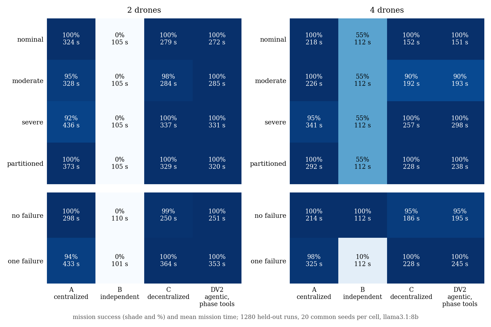
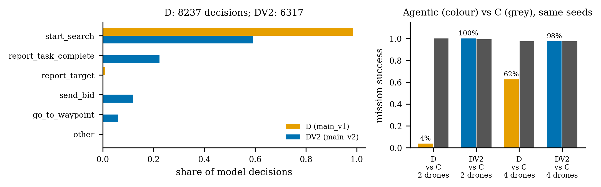

# Follow-up results: main_v2 (DV2 on fresh held-out seeds)

```powershell
python scripts/analyse_factorial.py results/main_v2
python scripts/make_paper_figures.py --only fig10_factorial_main_v2
python scripts/make_paper_figures.py --only fig11_d_vs_dv2
```

Numbers come from `paper/figure_data/factorial_main_v2.json`.

**This is a disclosed follow-up.** DV2 was designed after the main_v1 results
were seen (`FOLLOWUP_DV2.md`). It ran on held-out seeds 21–40, which no earlier
result used. main_v1, including D's 33%, stays in the paper as measured.

## Run summary

- Design `main_v2`: A, B, C and DV2 × 2 and 4 drones × 4 network conditions × 2 failure conditions = 64 cells, 20 common seeds each.
- Planner llama3.1:8b through Ollama, temperature 0, `num_gpu: all` in every DV2 run.
- Sealed at the first run (`configs/frozen/test_seal_main_v2.json`).
- 1,280 runs recorded, all valid, 64 of 64 cells complete.

**Development before the seal (development seeds only)**

- Run 1 (16 runs): 14 succeeded. The two failures came from accepting `report_task_complete` with nothing to report, which looped at one simulated instant. That is now a `wrong_phase` rejection.
- Run 2 was lost to a GPU out-of-memory error. All 16 runs were correctly excluded under X4 and kept as evidence.
- Run 3 (16 runs): 16 succeeded.

**One run re-run under X1**

- `DV2_n2_final_nominal_one_failure_s25294` was interrupted seconds after it started, and the next run began 9 minutes later.
- Its manifest said "running" with no error. The classifier wrongly counted it as a DV2 mission failure, and resume skipped it.
- The predeclared X1 criterion covers exactly this case ("the operator interrupted it"). The attempt was moved to `_excluded_attempts/` and the run re-ran under the sealed configuration; it succeeded.
- The classifier now applies X1 to such runs automatically (test plus injected defect `killed_run_counted_as_failure`). The fix was made after main_v2 finished.

## Main result

| comparison (paired by seed) | success | McNemar p (exact) | mean time difference (95% CI) |
|---|---|---|---|
| **C vs DV2** | 98.4% vs 98.8% | 1.0 | C faster by 4 s (−10 to +2) |
| A vs DV2 | 97.8% vs 98.8% | 0.55 | DV2 faster by 56 s (48–64) |
| C vs A | 98.4% vs 97.8% | 0.77 | C faster by 60 s (52–69) |
| C vs B | 98.4% vs 27.5% | 5 × 10⁻⁶³ | B never redistributes work |



- **With the tool-set gap closed, the agentic architecture matches the deterministic decentralized one.** Success and time are statistically indistinguishable overall, in every network condition and in both failure conditions.
- **DV2 is faster than centralized A by about a minute**, at the same reliability.
- **A, B and C reproduce main_v1 on new seeds** (main_v1: C 99%, A 98%, B 28%). The baselines are stable across seed sets.



| | D (main_v1) | DV2 (main_v2) |
|---|---|---|
| success, 2 drones | 4% | 100% |
| success, 4 drones | 62% | 98% |
| mean mission time | ~730 s | ~260 s |
| `start_search` share of decisions | 98.5% | 59% |

The seeds differ (1–20 vs 21–40), so compare each agentic agent with C on its
own seeds. C is 98–100% in both designs.

## What the model did (6,317 decisions in 320 runs)

| | |
|---|---|
| sector completions reported by the model | 1,414 |
| completions made by the fallback after a rejected wrong-phase choice | 181 (11%) |
| wrong-phase choices | 1,005 (16% of decisions); 824 corrected by the model after one hint |
| replies with bad parameters or message types | 540 |
| coordination streaks cut short (`coordination_not_converging`) | 284 |
| mean model latency | 16.3 s per decision |

Landing, waiting on the pad, standing by and "no work left" are handled
deterministically by design in every agentic variant, so they are not model
failures.

## Limitations to state

- **Mission time excludes thinking time.** Mission times are simulated, and model latency (16 s per decision on a 4 GB laptop GPU) is wall-clock and not charged to the mission. The same holds for D in main_v1. On real hardware an LLM agent would be slower unless decisions overlap with flight.
- **One new DV2-specific failure** (`DV2_n4_final_moderate_none_s83088`): under message loss the drones believed a finished sector was still open. The model kept choosing `start_search` without a task, which becomes a claim that takes no simulated time. All four drones looped at 147 s until the step cap and stayed airborne. C completed this seed. The result is kept as measured, since main_v2 was sealed.
- **Shared failures.** In 4-drone, moderate-loss, no-failure runs, C and DV2 both reach 90%, with a drone not landed on largely the same seeds. This comes from the deterministic landing logic both use, not from the model.

## Where the agentic architecture could be better

Not on this mission: DV2 equals C and beats A on time. The task is fully
specified, and C's rules are near-optimal by construction. What main_v2 does
show is that main_v1's gap came from the tool interface, not the model's
reasoning. With task phases explicit, an 8B model matches a hand-written
decentralized policy, and guardrails catch about 1 in 6 wrong-phase choices.

An advantage would have to come from situations the rules were not written for:
natural-language intent from an operator mid-mission, new task types or
events, free-text teammate reports, and trade-offs with no written rule. Each
needs its own predeclared scenario family and held-out seeds
(`FOLLOWUP_DV2.md`).
