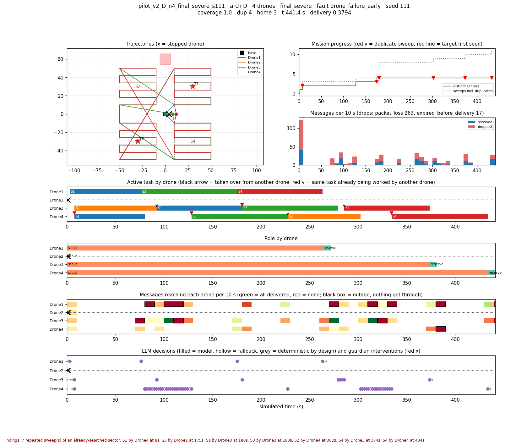
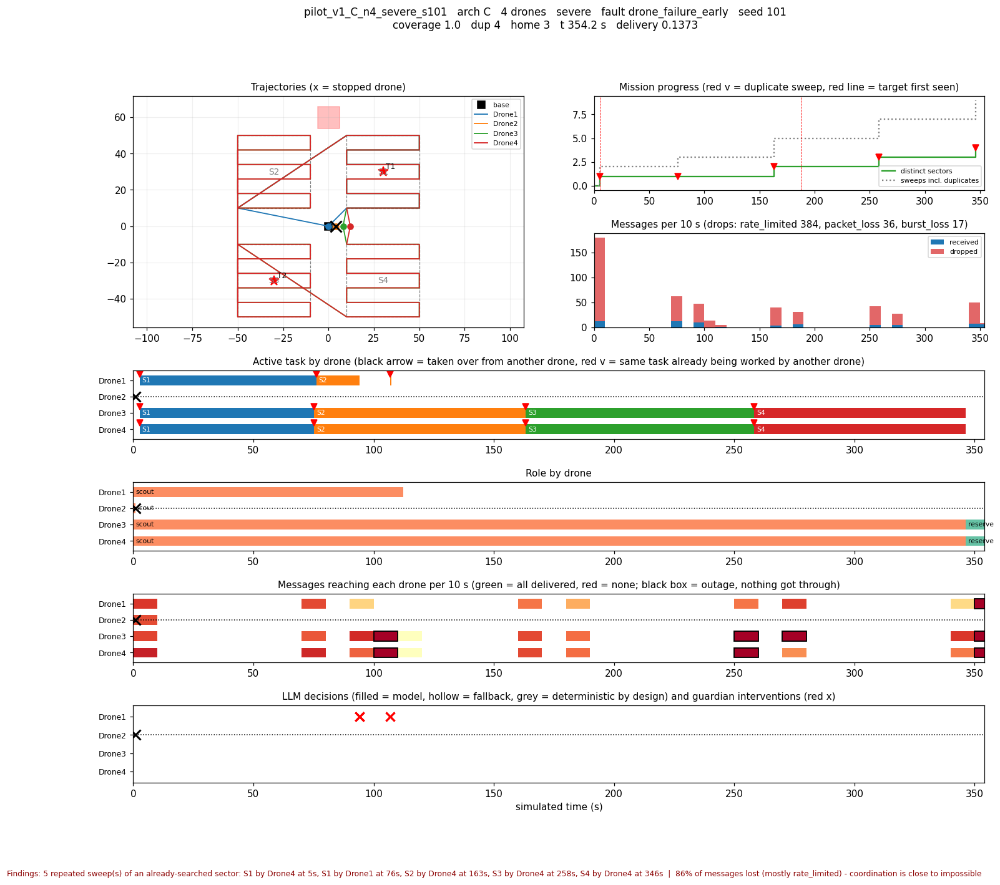
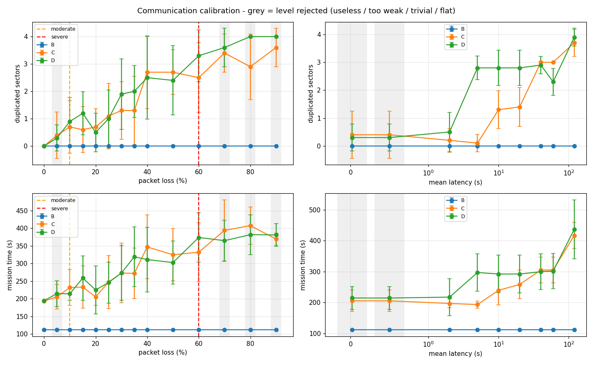

# docs/figures - pilot-stage plots (Phase 17)

These three plots come from the pilot runs before the main experiment. **"D"
here is a scripted stand-in that always picks the right action, not Llama.**
The point was to check that the code and the network settings worked, not to
test the model. Real-LLM results are in `paper/figures/fig8`–`fig11` (see
`docs/FIGURES_GUIDE.md`).

## pilot_timeline_D_n4_final_severe.png

One run (D, 4 drones, 50% message loss, Drone2 dies at the start), redrawn
using only the files the run saved.

- **Trajectories:** where each drone flew. X = the drone that died.
- **Mission progress:** green = distinct sectors searched, dotted = sweeps including repeats. Red triangles = a sector flown again.
- **Messages per 10 s:** blue arrived, red dropped.
- **Active task by drone:** which sector each drone was working on over time. Black arrow = took over a dead drone's task; red triangle = someone was already on it.
- **Role by drone:** scout / relay / reserve.
- **Messages reaching each drone:** green = all arrived, red = none, black box = full outage.
- **LLM decisions:** each dot is a decision. Filled = model, hollow = backup.
- **Red text at the bottom:** problems found automatically (here, 7 repeat sweeps).

We used these plots to find bugs the averages hid. Four were found and fixed,
for example a dead drone's old bid beating the living drone, so its sector
never got flown.

## pilot_timeline_C_n4_old_severe.png

Same plot for C under our **first** "severe" setting. 86% of messages were
lost, mostly to a rate limiter rather than random loss. The drones end up
flying every sector together as a pack (the task rows are identical), and
every seed gave the same result. That setting measured a simulator quirk, not
the network, so we replaced it.

## comms_calibration.png

How the final network levels were chosen. We raised packet loss (left) and
delay (right) step by step and measured repeated sectors (top) and mission
time (bottom) for B, C and D.

- B never talks, so it stays flat. That confirms we are measuring coordination.
- C and D get worse as loss rises.
- Grey bands = levels thrown out: too easy to matter, so bad nothing works, or every seed identical.
- Dashed lines = the levels we kept: moderate 10% loss, severe 50% loss.
